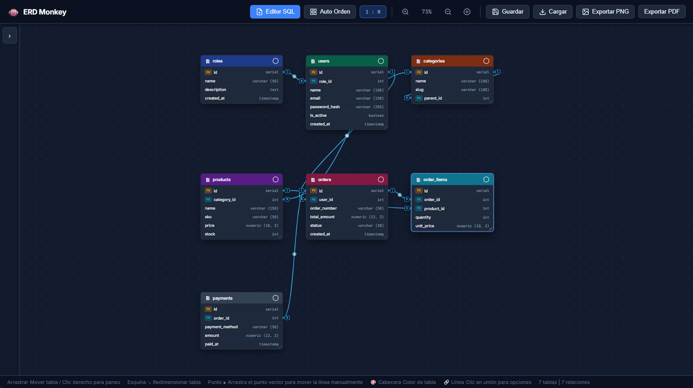
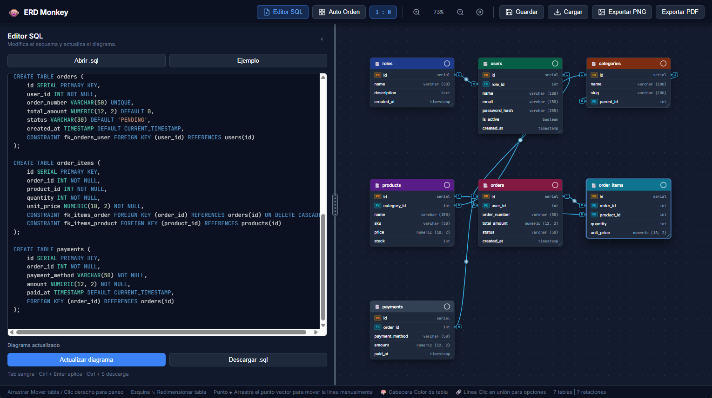
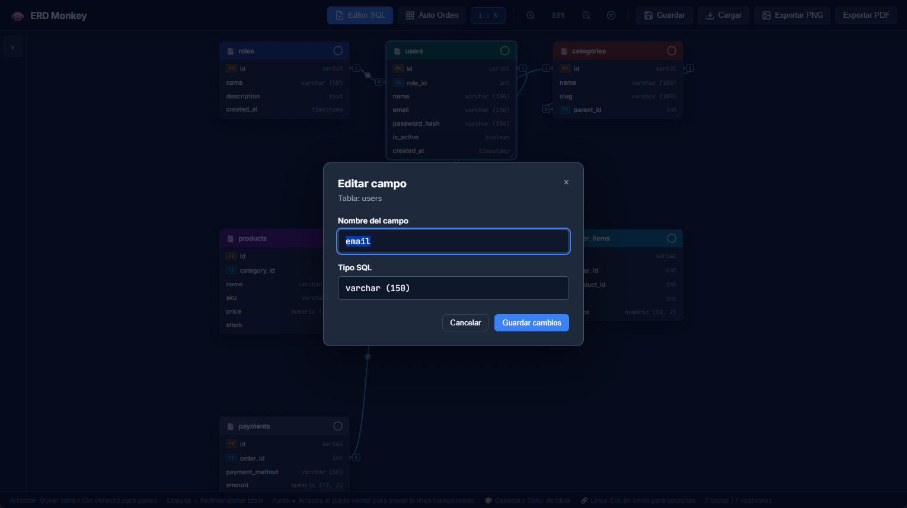
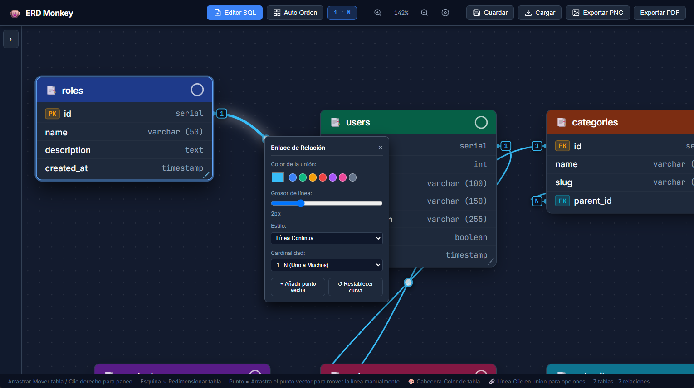
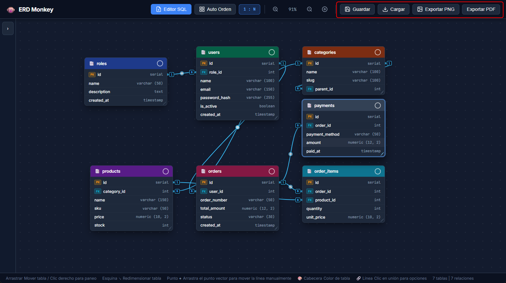

# ⚡ ERD Monkey

[Español](README.md) | **English**

An interactive entity–relationship diagram (ERD) editor for **PostgreSQL** SQL scripts. The application interface is currently in Spanish; the button labels below match the interface.

## User guide

### 1. Open the application

Download or clone this repository and double-click **`index.html`** to open it in Chrome, Edge, Firefox, or Brave. No dependencies or database connection are required. An example schema appears on startup.



### 2. Load and apply SQL

In the **Editor SQL** panel, type or paste SQL, select **Abrir .sql** to open a file, or choose **Ejemplo**. Select **Actualizar diagrama** or press `Ctrl + Enter` to generate tables and relationships. Review any warnings. To download the SQL, select **Descargar .sql** or press `Ctrl + S`.



### 3. Edit fields

Double-click a field, or focus it and press `Enter`. In **Editar campo**, change its name or type and select **Guardar cambios**. The SQL and diagram update together. Apply pending SQL edits first; if a name appears elsewhere in the SQL, change it in the SQL editor so you can review its references.



### 4. Arrange the diagram

Drag table headers to move tables and their bottom-right corners to resize them. Use the color picker in each header to distinguish modules. Drag the background to pan, and use the mouse wheel or toolbar buttons to zoom. **Auto Orden** arranges tables automatically.

Click a relationship line to change its color, width, style, or cardinality. Drag the circular point to adjust its path; double-click the point to reset it.



### 5. Save and export

Select **Guardar** to download a JSON project and **Cargar** to restore one. The browser also attempts to save your work automatically; keep a JSON copy as a backup. Select **Exportar PNG** or **Exportar PDF** to download the diagram.



## Features

- PostgreSQL DDL importer for tables, columns, primary keys, unique constraints, and foreign keys, including composite keys and constraints added with `ALTER TABLE`.
- Table cards with PK and FK indicators and curved relationship lines.
- Table colors, positions, and sizes; drag the resize handle or use the arrow keys while it is focused (`Shift` increases the step).
- Custom relationship colors, line widths and styles, cardinality labels, and draggable control points. Use **+ Añadir punto vector** to add a point and **↺ Restablecer curva** to reset the curve.
- Automatic `1:1` detection when the foreign key is unique, manual `1:N`, `1:1`, and `N:N` selection, and a toolbar switch to show or hide cardinalities.
- A SQL editor with syntax highlighting, adjustable width, file import and download, and draft autosave. `Tab` inserts indentation; collapse or reopen it using **Editor SQL**.
- JSON project save and load, browser autosave, and PNG or single-page PDF export.

## SQL importer coverage

The importer recognizes schema-qualified tables, quoted identifiers, primary and unique keys, inline references, table constraints, and composite foreign keys. It also recognizes primary, unique, and foreign keys added with `ALTER TABLE ... ADD`. References without an explicit column list use the target table's primary key.

Definitions that cannot be interpreted and references to missing tables or columns are reported as warnings. The importer is a partial PostgreSQL DDL parser, not a complete PostgreSQL validator; it does not execute SQL or connect to a database.

Run the parser tests with Node.js:

```sh
node tests/parser.test.js
```

## Code structure

- `sql-parser.js`: PostgreSQL SQL tokenization and extraction of tables, columns, constraints, and relationships.
- `sql-highlighter.js`: dependency-free SQL syntax highlighting.
- `app.js`: interface, rendering, canvas interaction, and project persistence.
- `index.html`: loads the parser and highlighter before the application. Classic scripts keep direct opening of `index.html` working.
