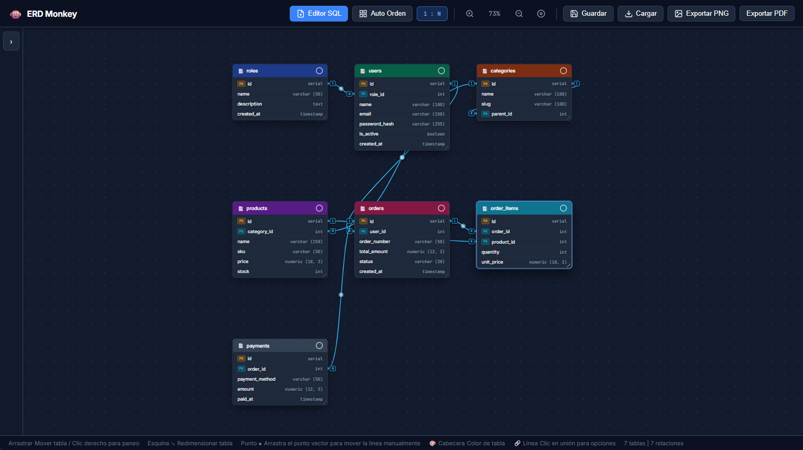
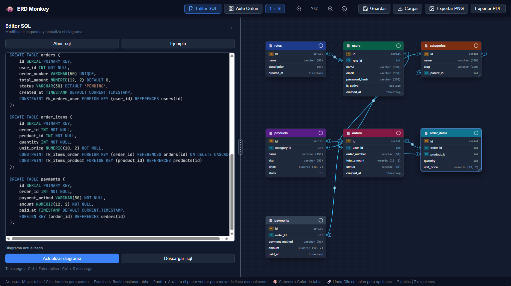
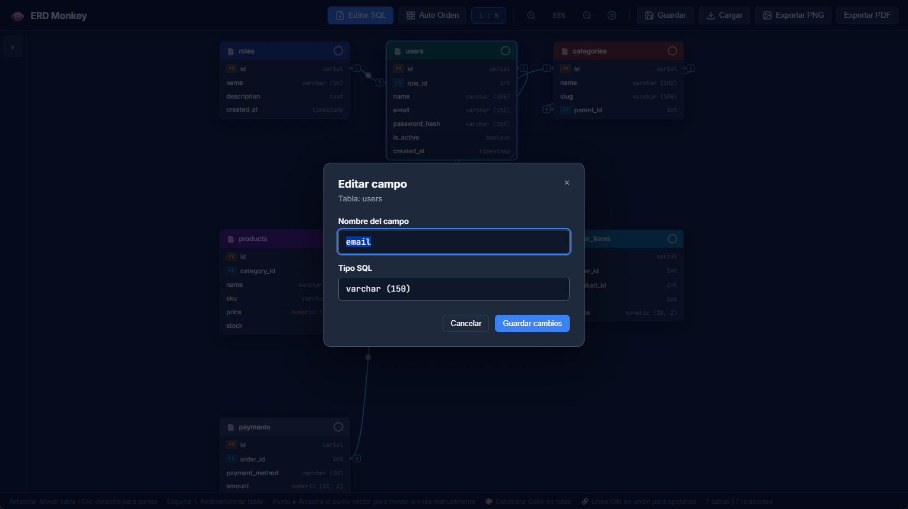
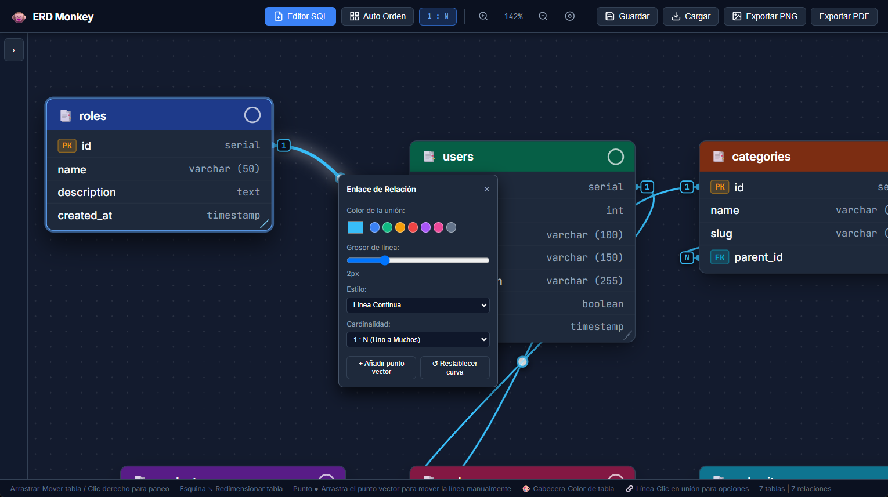
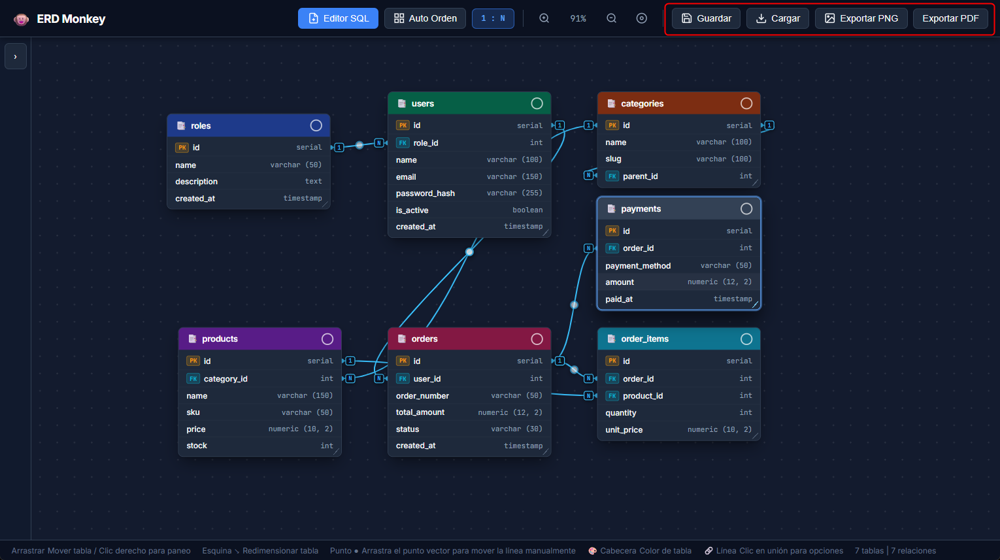

# ⚡ ERD Monkey

**Español** | [English](README.en.md)

Modelador visual interactivo de diagramas Entidad-Relación (ERD) diseñado específicamente para scripts SQL de **PostgreSQL**.

---

## 🚀 Guía de uso

### 1. Abrir la aplicación

Descarga o clona este repositorio y abre **`index.html`** con doble clic en Chrome, Edge, Firefox o Brave. No necesitas instalar dependencias ni conectarte a una base de datos. Al iniciar verás un esquema de ejemplo.

### 2. Cargar y aplicar SQL

En el panel **Editor SQL**, escribe o pega tu código, pulsa **Abrir .sql** para cargar un archivo o usa **Ejemplo**. Pulsa **Actualizar diagrama** o `Ctrl + Enter` para generar las tablas y relaciones. Si aparecen advertencias, revisa las definiciones indicadas. Para descargar el SQL del editor, pulsa **Descargar .sql** o `Ctrl + S`.

### 3. Editar campos

Haz doble clic en un campo, o selecciónalo con el teclado y pulsa `Enter`. En la ventana **Editar campo**, cambia el nombre o el tipo y pulsa **Guardar cambios**. El SQL y el diagrama se actualizan. Primero aplica cualquier cambio pendiente del editor; si un nombre aparece en otra parte del SQL, modifícalo desde el editor para revisar sus referencias.

### 4. Organizar el diagrama

Arrastra las cabeceras para mover las tablas y su esquina inferior derecha para cambiar el tamaño. Usa el selector de color de cada cabecera para distinguir módulos. Arrastra el fondo para desplazar el lienzo y utiliza la rueda del ratón o los botones de la barra para acercar o alejar. **Auto Orden** reorganiza las tablas.

Haz clic en una línea para cambiar su color, grosor, estilo o cardinalidad. Arrastra el punto circular de la línea para ajustar su recorrido; con doble clic puedes restablecerlo.

### 5. Guardar y exportar

Pulsa **Guardar** para descargar el proyecto como JSON y **Cargar** para recuperarlo posteriormente. El navegador también intenta guardar el trabajo automáticamente; conserva una copia JSON para respaldarlo. Usa **Exportar PNG** o **Exportar PDF** para descargar el diagrama.

## 🌟 Características Clave
1. **Lector de PostgreSQL**:
   - Interpreta `CREATE TABLE`, tipos de datos (`SERIAL`, `INT`, `VARCHAR`, `NUMERIC`, `UUID`, etc.).
   - Detecta `PRIMARY KEY` (inline o por restricción de tabla).
   - Detecta `FOREIGN KEY / REFERENCES` (inline o por restricciones `ALTER TABLE / CONSTRAINT`).
2. **Generación automática de tablas y relaciones**:
   - Dibuja tarjetas de tablas con columnas, tipos y etiquetas visuales (`PK`, `FK`).
   - Genera líneas curvas Bézier automáticas entre las columnas conectadas.
3. **Personalización de color por tabla**:
   - Cada tabla tiene un selector de color en su cabecera. Puedes elegir el tono que prefieras para agrupar tablas por módulos (ventas, usuarios, productos, etc.).
4. **Personalización de color y estilo por enlace**:
   - Haz clic en cualquier línea de relación para cambiar su color con la paleta, ajustar el grosor o cambiar entre línea continua o discontinuada.
5. **Indicadores de Cardinalidad Minimalistas (`1` y `N`)**:
   - Cada enlace muestra micro-etiquetas estilizadas cerca de los puertos de las tablas: `1` en el extremo de la clave primaria (PK) y `N` en el extremo de la clave foránea (FK).
   - **Detección automática**: Detecta relaciones `1:1` cuando la clave foránea es `UNIQUE` o forma parte de la clave primaria.
   - **Selector manual**: En el menú flotante de la línea puedes forzar la relación a `1:N`, `1:1` o `N:N`.
   - **Interruptor en la barra superior (`1:N`)**: Activa o desactiva la visibilidad de los badges de cardinalidad con un solo clic para mantener el diagrama 100% despejado cuando tengas muchas tablas.
6. **Control manual de líneas con Puntos Vectoriales**:
   - Cada enlace cuenta con un **punto vector (handle circular ●)** en el centro de la línea.
   - Solo **arrastra ese punto con el mouse** para mover o curvar la línea manualmente en cualquier dirección (ideal para separar líneas paralelas o que se cruzan).
   - Puedes hacer **doble clic en el punto** para restablecer la curva a automática.
   - En el menú flotante del enlace tienes botones para **"+ Añadir punto vector"** o **"↺ Restablecer curva"**.
7. **Control manual de orden, posiciones y tamaño**:
   - Arrastra libremente cada tabla para acomodarla exactamente como quieras.
   - Arrastra la esquina inferior derecha para ajustar el ancho y el alto de cada tabla. Si el alto es menor que el contenido, puedes desplazarte dentro de la tarjeta; las dimensiones se conservan al guardar, exportar o volver a aplicar el SQL.
   - Con el control de tamaño seleccionado, usa las flechas para cambiar ancho y alto (`Shift` aumenta el paso).
   - Paneo del lienzo manteniendo presionado el **clic derecho** o arrastrando el fondo.
   - Zoom suave con la **rueda del ratón** o los botones de la barra superior.
   - Botón **"Auto Orden"** si deseas una distribución automática inicial.
8. **Guardar y Exportar**:
   - **Guardar / Cargar**: Exporta e importa tu diagrama en archivo `.json` conservando posiciones, tamaños y colores manuales.
   - **Autoguardado**: Intenta guardar automáticamente el trabajo en tu navegador; conserva una copia JSON como respaldo.
   - **Exportar PNG o PDF**: Descarga el diagrama como imagen o PDF de una página.

Para editar un campo, haz doble clic en su fila o selecciónala con el teclado y pulsa Enter. Introduce el nombre y el tipo en la ventana de edición. El SQL se actualiza junto con el diagrama. Aplica primero los cambios pendientes del editor. Si el nombre aparece en otra parte del SQL, cámbialo desde el editor para revisar sus referencias y restricciones.

## Cobertura del importador SQL

El importador está enfocado en DDL de PostgreSQL. Reconoce tablas con esquema, identificadores entrecomillados, claves primarias y únicas, referencias inline o declaradas como restricciones, y claves foráneas compuestas. Reconoce también claves primarias, únicas y foráneas agregadas mediante `ALTER TABLE ... ADD`. Las referencias sin lista explícita de columnas se resuelven usando la clave primaria de la tabla destino. Es un importador parcial, no un validador completo de PostgreSQL.

Para ejecutar las pruebas del importador con Node.js: `node tests/parser.test.js`.

Las definiciones que no se puedan interpretar y las referencias a tablas o columnas que falten se informan como advertencias al generar el diagrama. El importador no ejecuta el SQL ni conecta con una base de datos.

El editor SQL está integrado en el panel lateral, con resaltado de palabras clave, tipos, funciones, cadenas, números y comentarios. Arrastra el divisor para ajustar su ancho o enfócalo y usa las flechas; el tamaño se conserva en el proyecto. Puedes abrir un archivo, editar su contenido, descargar la versión modificada (`Ctrl + S`) y pulsar **Actualizar diagrama** (`Ctrl + Enter`). `Tab` inserta sangría. El texto se guarda automáticamente como borrador; al plegar el panel queda una pestaña para volver a mostrarlo, y también puedes abrirlo desde **Editor SQL** en la barra superior.

## Estructura del código

- `sql-parser.js`: tokenización del SQL PostgreSQL y extracción de tablas, columnas, restricciones y relaciones.
- `sql-highlighter.js`: resaltado de sintaxis seguro para el editor SQL, sin dependencias externas.
- `app.js`: interfaz, renderizado, interacción del lienzo y persistencia del proyecto.
- `index.html` carga el parser y el resaltador antes de la aplicación. Se mantiene el uso de scripts clásicos para que abrir `index.html` directamente en el navegador siga funcionando.
